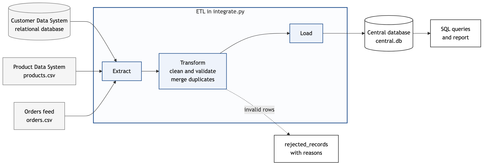
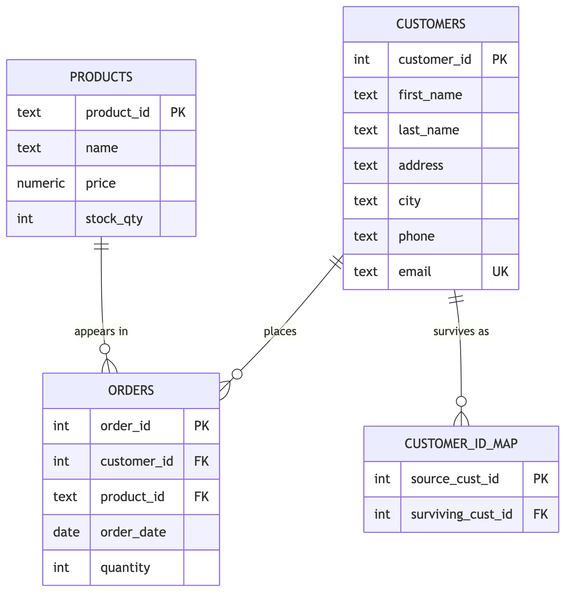

# Module 3 Mini-Project: Integrating Multiple Data Sources into a Centralized Database

An ETL pipeline that integrates **customer data from a relational database** and **product data from a
CSV file** (plus an orders feed) into one central SQLite database, then answers business questions with SQL.
It uses only the Python standard library (`sqlite3`, `csv`), so nothing needs installing.



## Run it

```sh
python integrate.py      # Extract -> Transform (clean, validate, de-duplicate) -> Load into central.db
python run_queries.py    # runs every query in queries.sql and writes query_results.txt
```

`integrate.py` rebuilds `central.db` from scratch on every run, so the output is the same each time.
The outputs of a real run are saved in `etl_log.txt` and `query_results.txt`.

## Data sources

| Source | File | What it holds |
|---|---|---|
| Customer Data System (relational) | `sources/customers_source.sql` → loaded into `customers_source.db` | Customer IDs, names, addresses and contacts |
| Product Data System (CSV) | `sources/products.csv` | Product IDs, names, prices and stock |
| Orders feed (CSV) | `sources/orders.csv` | Sample orders linking customers to products |

Realistic data-quality problems are planted on purpose so that the validation has something to catch.

## Central schema



Defined in `schema.sql`. It has primary and foreign keys plus `CHECK` constraints (price > 0, stock ≥ 0,
quantity > 0, valid dates), a `customer_id_map` table recording which duplicate customers were merged, and a
`rejected_records` table that keeps every rejected row with its reason.

## Validation results

| Outcome | Records |
|---|---|
| **Rejected (7)** | customer with no name · product with no price · duplicate product row · orders with an unknown customer, an unknown product, quantity 0, and the date `2026-13-01` |
| **Fixed and flagged (5)** | duplicate customer merged by email (and its order remapped) · invalid phone set to NULL · negative stock set to 0 · missing email noted |
| **Loaded** | 7 customers · 7 products · 10 orders |

## Queries (`queries.sql`)

| Query | Question answered |
|---|---|
| Q1 | Customer details with the products they ordered |
| Q2 | Total value of orders per customer |
| Q3 | Products priced between KES 1,000 and KES 5,000 |
| Q4 | Customers with an order worth more than KES 10,000 |
| R1 | Report: total orders, units sold and revenue per product |

Total revenue is **KES 99,900**, and it is the same whether summed per product (R1) or per customer (Q2).
That cross-check confirms no order was lost or double-counted.

## Files

| Path | What it is |
|---|---|
| `integrate.py` | The ETL script |
| `schema.sql` | Central database schema |
| `queries.sql` · `run_queries.py` | SQL queries and a runner that prints aligned results |
| `sources/` | The three source datasets |
| `etl_log.txt` · `query_results.txt` | Output of a real run |
| `*.mmd` · `*.png` | Mermaid diagram sources and rendered images |
