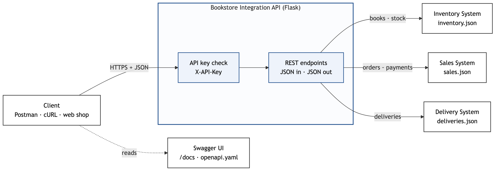
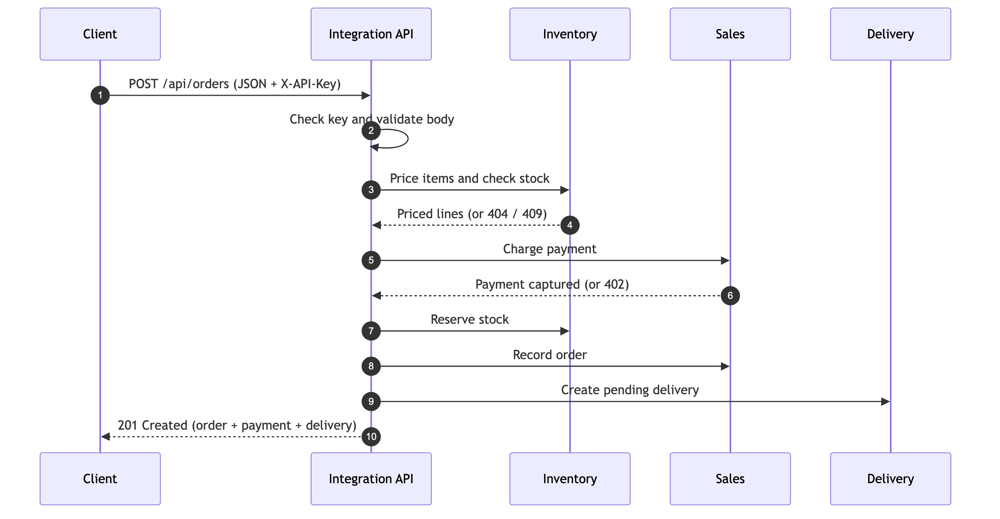

# Module 4 Mini-Project: RESTful API for Multi-System Integration

A Flask REST API that integrates the three subsystems of a fictional **Bookstore Management System**:

| Subsystem | Responsibility | Mock data store |
|---|---|---|
| Inventory System | Book details and stock | `data/runtime/inventory.json` |
| Sales System | Customer orders and payments | `data/runtime/sales.json` |
| Delivery System | Order deliveries | `data/runtime/deliveries.json` |

Each subsystem is a separate module in `bookstore_api/services/` with its own JSON file. The API in
`bookstore_api/__init__.py` is the single front door that coordinates them. The runtime files are
copied fresh from `data/seed/` on every start, so each run begins from the same data.



## Endpoints

All `/api` endpoints except `/api/health` need the header `X-API-Key`. The local test key is
`dev-key-123`; set `BOOKSTORE_API_KEY` to change it.

| Method | Path | System | Purpose |
|---|---|---|---|
| GET | `/api/health` | — | Health check (no key needed) |
| GET | `/api/books` | Inventory | List all books |
| GET | `/api/books/{book_id}` | Inventory | Get book details |
| POST | `/api/orders` | Sales → Inventory → Delivery | Place an order, process payment, reduce stock, create a delivery |
| GET | `/api/orders/{order_id}` | Sales | Get an order |
| GET | `/api/deliveries/{delivery_id}` | Delivery | Get a delivery |
| PUT | `/api/deliveries/{delivery_id}` | Delivery | Update status, courier, tracking number or address |
| GET | `/docs` | — | Swagger UI (reads `openapi.yaml`) |

Status codes: `200` OK · `201` order created · `400` invalid input · `401` missing or wrong key ·
`402` payment declined · `404` not found · `409` not enough stock. Errors always look like
`{"error": {"code": "...", "message": "..."}}`.

Payments are simulated like a gateway's test mode: any token is approved except `tok_declined`.



## Run it

```sh
pip install -r requirements.txt
python run.py                  # http://127.0.0.1:5055  ·  docs at http://127.0.0.1:5055/docs
python -m pytest -v tests      # 20 unit tests
bash curl_demo.sh              # end-to-end cURL test against a live server -> curl_demo_output.txt
```

Example order:

```sh
curl -X POST http://127.0.0.1:5055/api/orders \
  -H "X-API-Key: dev-key-123" -H "Content-Type: application/json" \
  -d '{"customer":{"name":"Amina Wanjiru","email":"amina@example.com"},
       "items":[{"book_id":"B001","quantity":2}],
       "payment":{"method":"mpesa","token":"tok_test_123"},
       "delivery_address":"12 Moi Avenue, Nairobi"}'
```

## Files

| Path | What it is |
|---|---|
| `bookstore_api/__init__.py` | API layer: auth, validation, routes, order orchestration |
| `bookstore_api/services/` | The three mock subsystems and the JSON store |
| `openapi.yaml` | OpenAPI 3 specification (served at `/docs`) |
| `tests/test_api.py` | pytest unit tests |
| `curl_demo.sh` · `curl_demo_output.txt` | cURL test script and the output of a real run |
| `*.mmd` · `*.png` | Mermaid diagram sources and rendered images |
| `swagger_ui.jpg` | Screenshot of the running Swagger UI |
